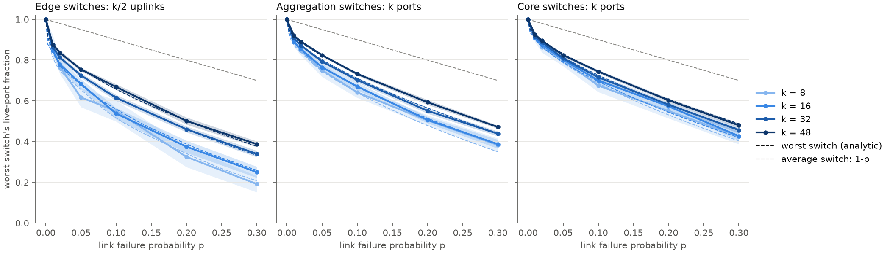

# Fat-Tree Topology Generator & Failure Analysis

## 1. Quick start

**Requirements:** Python ≥ 3.12 and [uv](https://docs.astral.sh/uv/).

```bash
git clone <repo-url> && cd <repo>
uv sync                      # install dependencies into .venv
uv run pytest                # run all tests (topology, failures, metrics, CLI)
```

**Reproduce all figures:**
```bash
uv run draw_topology.py --k 4                     # Figure 1 -> Resources/topology_k4.png
uv run simulate.py --config configs/exp_1.yaml    # Experiment 1 (§5) -> results/Exp_1
uv run plot_exp_1.py results/Exp_1/results.csv    # writes exp1_mean.png, exp1_worst.png, exp1_ports.png next to the CSV
```

**Single run example:** k=8, 5% link failures, 50 trials.
```bash
uv run simulate.py --k 8 --fail-rate 0.05 --trials 50 --out results/demo
```

### Inputs

Inputs can be given on the command line or in a YAML config file (`--config`). Keys are the flag names with underscores. Command-line values override the config file. Flags marked *sweep* accept several values, and the program runs every combination.

| Flag | Default | Meaning |
|---|---|---|
| `--k` *(sweep)* | required | Ports per switch. Even, 4 ≤ k ≤ 254 (one-byte addressing of [1, §3.2]). |
| `--fail-rate` *(sweep)* | `0` | Link failure rate p ∈ [0, 1]. |
| `--fail-scope` | `switch-links` | `switch-links` (switch-to-switch links only) or `all-links` (host–edge links too). See §4.1. |
| `--trials` | `30` | Independent failure samples for each parameter combination. Plots show the mean ± 95% CI over trials. |
| `--seed` | `0` | Base random seed; trial t uses seed + t (§4.2). |
| `--config` | none | YAML file with any of the flags above. |
| `--out` | `results` | Output directory. |

### Outputs (`--out DIR`)

- `config.json`: the exact parameters used, after combining the command line and the config file.
- `results.csv`: one row per (k, p, trial). Statistics end with `_mean` (the mean) or `_min` (the worst).
  - `intra_*`, `inter_*`: surviving shortest paths per pair, for pairs in the same pod or in different pods (§4.3).
  - `{layer}_ports_*`, layer ∈ {`edge`, `agg`, `core`}: live switch-to-switch ports per switch (§4.5).
- `plot_exp_1.py` writes the figures (`exp1_mean.png`, `exp1_worst.png`, `exp1_ports.png`) next to the CSV.

## 2. Topology
We build the canonical k-ary fat-tree of [1, §2.2]: k pods of k/2 edge and k/2 aggregation switches, (k/2)² core switches, k³/4 hosts. Core row i connects to aggregation switch i of every pod.


*Figure 1: The k=4 fat-tree built by our generator, with the addresses of [1, §3.2]. Each edge switch and its k/2 hosts form one /24 subnet (10.pod.switch.0/24). Generated by `uv run draw_topology.py --k 4`.*

## 3. Implementation

| File | Role |
|---|---|
| `fattree/topology.py` | `build_fat_tree(k)`: builds the fat-tree of §2 as a NetworkX graph. Nodes carry layer, pod and IP address; links carry their class and port numbers. |
| `fattree/failures.py` | `inject_failures(...)`: returns a failed copy of the graph (§4.1–4.2). |
| `fattree/metrics.py` | `surviving_paths(...)`: surviving shortest paths per edge-switch pair (§4.3). `live_ports(...)`: live switch-to-switch ports per switch layer, and `expected_worst_ports(...)`, the analytic expectation for the worst switch (§4.5). |
| `simulate.py` | Experiment runner: parameter sweeps, trials, seeds; writes `results.csv` and `config.json`. |
| `plot_exp_1.py` | Experiment 1 figures (§5.1): mean ± 95% CI over trials, with the analytic curves of §4.4 (surviving paths) and §4.5 (live ports). At most 4 values of k per CSV. |
| `draw_topology.py` | Draws the topology (Figure 1), optionally with failures marked. k ≤ 8. |

**Path counting.** Paths are never enumerated. For each failed graph we build two boolean arrays: `up[pod, edge, i]` (edge–aggregation links alive) and `core[pod, i, j]` (aggregation–core links alive). From these, `shared[x, y, i] = Σ_j core[x,i,j]·core[y,i,j]` counts the cores in row i that reach both pods x and y. The number of surviving paths of a pair is then

- intra-pod: Σᵢ up[e₁,i]·up[e₂,i]
- inter-pod: Σᵢ up[e₁,i]·up[e₂,i]·shared[x₁,x₂,i]

This is vectorized over all pairs with NumPy. The live-port metric (§4.5) sums the same `up` and `core` arrays per switch.

## 4. Failure Modeling
### 4.1 What can fail
- **Links** (`--fail-rate p`). By default (`--fail-scope switch-links`), only switch-to-switch links can fail: edge–aggregation and aggregation–core, k³/2 links in total. These are the two failure classes the paper's fault-tolerance scheme can route around ([1, §3.8]). Host–edge links are excluded by default: a host has a single uplink, so losing it disconnects the host whatever the fabric does. `--fail-scope all-links` adds them, which only adds losses that no routing scheme can avoid. All experiments in this report use `switch-links`, the failures the paper's design is meant to survive, and the analysis of §4.4–4.5 assumes this scope.
### 4.2 How failures are sampled
Failures are independent Bernoulli trials: every eligible link fails with probability p, independently of all other links. The failure percentage from the assignment is therefore read as a per-link failure probability.

**Seeds and nesting.** Trial t uses seed `seed + t`. Each link gets one uniform draw u and fails if u < p. The draws do not depend on the rate, so for a fixed seed the failure sets are nested: everything that fails at p = 0.05 also fails at p = 0.1. All rates are compared on the same random draws (common random numbers), which keeps the curves smooth and monotone.
### 4.3 What counts as a surviving path
We count **shortest (equal-cost) paths** between pairs of edge switches. Under `switch-links` scope, every host under an edge switch sees the same paths, so edge switches are the exact endpoints. Pairs under the same edge switch are excluded, because their traffic never enters the fabric. Because of the fat-tree structure, every shortest path is determined by the choice of an aggregation switch and, between pods, a core switch:
- **Same pod:** e₁ → aggregation switch aᵢ → e₂. There are k/2 paths in total, one per i ∈ {1,…,k/2}.
- **Different pods:** e₁ → aᵢ (pod 1) → core c_{i,j} → aᵢ (pod 2) → e₂. Core row i connects only to aggregation switch i in every pod, so both pods use the same i. There are (k/2)² paths in total, one per (i, j).

A path **survives** if all of its links are alive.
### 4.4 Expected surviving paths
We derive the expected number of surviving shortest paths between a pair of edge switches. All failures are independent (§4.2). Let $s = 1-p$ be the probability that a link survives.

**Intra-pod pairs.** Path $e_1 \leftrightarrow a_i \leftrightarrow e_2$ (§4.3) needs its two links to survive. These are independent events, so its indicator is $B_i \sim \mathrm{Ber}(s^2)$. Different paths use disjoint links, so the $B_i$ are **independent**, and the number of surviving paths $X = \sum_{i=1}^{k/2} B_i \sim \mathrm{Bin}(k/2, s^2)$:

$$\mathbb{E}[X_{\text{intra}}] = \frac{k}{2}\cdot s^2$$

**Inter-pod pairs.** Path $(i,j)$ is $e_1 \leftrightarrow a_i^{(1)} \leftrightarrow c_{i,j} \leftrightarrow a_i^{(2)} \leftrightarrow e_2$ (§4.3), where $a_i^{(1)}$ and $a_i^{(2)}$ are the $i$-th aggregation switches of the two pods and $c_{i,j}$ is the $j$-th core switch of row $i$. It needs its four links to survive, so $B_{i,j} \sim \mathrm{Ber}(s^4)$. Unlike the intra-pod case, the $B_{i,j}$ are **not independent**: the $k/2$ paths of row $i$ share both edge–aggregation links, $e_1 \leftrightarrow a_i^{(1)}$ and $a_i^{(2)} \leftrightarrow e_2$, so if one of those fails, all $k/2$ paths of row $i$ fail together. $X = \sum_{i=1}^{k/2}\sum_{j=1}^{k/2} B_{i,j}$ is therefore not binomial. Linearity of expectation does not require independence, however, so

$$\mathbb{E}[X_{\text{inter}}] = \sum_{i=1}^{k/2}\sum_{j=1}^{k/2} \mathbb{E}[B_{i,j}] = \left(\frac{k}{2}\right)^2\cdot s^4$$

Normalized by the number of paths in the healthy network ($k/2$ and $(k/2)^2$), the expected fraction of surviving paths is $s^2$ intra-pod and $s^4$ inter-pod, independent of $k$.

These are per-pair expectations: by linearity they hold however failures are correlated across pairs, but they say nothing about how the damage is distributed. The worst pair (`*_min`) and the trial-to-trial spread depend on the joint failure pattern and have no simple closed form, so the simulation measures them and uses the expectations above to validate itself.

### 4.5 Live ports per switch
For every switch we count its live switch-to-switch ports: an edge switch's uplinks ($n = k/2$; host ports are not counted), an aggregation switch's uplinks and downlinks ($n = k$), and a core switch's downlinks ($n = k$). Let $s = 1-p$.

A switch keeps $L \sim \mathrm{Bin}(n, s)$ of its $n$ ports, so the mean live fraction is $s$ in every layer. Within a layer, switches share no switch-to-switch link (each such link joins two different layers), so their $L$ values are independent. For a layer of $N$ switches, the worst switch therefore satisfies

$$P(\min L \ge m) = P(\mathrm{Bin}(n, s) \ge m)^N, \qquad \mathbb{E}[\min L] = \sum_{m=1}^{n} P(\mathrm{Bin}(n, s) \ge m)^N$$

| Layer | Switches N | Ports n |
|---|---|---|
| Edge | k²/2 | k/2 |
| Aggregation | k²/2 | k |
| Core | (k/2)² | k |

This bounds the worst pair. Every shortest path leaves an edge switch through one of its uplinks (§4.3), so a pair touching an edge switch with $L$ live uplinks keeps at most $L$ of its $k/2$ intra-pod paths, and at most $L$ of its $k/2$ inter-pod rows of $k/2$ paths each. Either way it keeps at most a fraction $L/(k/2)$ of its paths, so the worst pair's surviving fraction is at most the worst edge switch's live-uplink fraction.

## 5. Experiments

### 5.1 Experiment 1: surviving shortest paths vs. link failure probability

#### Question
How much shortest-path diversity does a fat-tree keep when switch-to-switch links fail at random, and how does that depend on the switch size k? Concretely:
1. **Average pair:** does the mean fraction of surviving shortest paths per edge-switch pair follow the expectations of §4.4, $s^2$ intra-pod and $s^4$ inter-pod, for every k?
2. **Worst pair:** how far below the average does the worst-off pair of edge switches fall, and how does that gap change with k?
3. **Worst switch:** how many live ports does the worst switch of each layer keep, and does the worst edge switch explain the worst pair?

#### Setup
| Parameter | Value |
|---|---|
| Switch size k | 8, 16, 32, 48 (128 to 27,648 hosts; k = 48 is the example of [1, §2.2]) |
| Link failure probability p | 0, 0.01, 0.02, 0.05, 0.1, 0.2, 0.3 |
| Trials | 30 independent failure samples per (k, p), seeds 0–29 |

**Measured per trial**, separately for intra-pod and inter-pod pairs: the mean and the minimum (worst pair) over pairs of the surviving fraction, (surviving shortest paths) / (k/2 or (k/2)²). Per layer (edge, aggregation, core), also the worst switch's live-port fraction, (live switch-to-switch ports) / n (§4.5).

Each plotted point is the mean over the 30 trials, with a 95% confidence interval (Student-t).

#### Results


*Figure 2: Mean fraction of surviving shortest paths per edge-switch pair vs. link failure probability p.*


*Figure 3: The worst-off pair's fraction of surviving shortest paths vs. p.*



*Figure 4: The worst switch's fraction of live switch-to-switch ports vs. p, per layer.*

| p = 0.1 | k = 8 | k = 16 | k = 32 | k = 48 |
|---|---|---|---|---|
| mean, intra-pod (analytic 0.810 for every k) | 0.816 | 0.807 | 0.810 | 0.809 |
| mean, inter-pod (analytic 0.656 for every k) | 0.664 | 0.655 | 0.655 | 0.655 |
| worst pair, intra-pod | 0.375 | 0.350 | 0.412 | 0.469 |
| worst pair, inter-pod | 0.150 | 0.161 | 0.260 | 0.317 |
| worst edge switch, live uplinks | 0.550 | 0.538 | 0.615 | 0.668 |
| worst edge switch, live uplinks (analytic, §4.5) | 0.516 | 0.559 | 0.620 | 0.657 |

#### Discussion
**The average pair matches the analysis (Figure 2).** For k ≥ 16, every point is within 0.003 of $(1-p)^2$ and $(1-p)^4$, which validates the simulator. The average surviving fraction does not depend on k. Larger fabrics only reduce the trial-to-trial noise, because they average over more links.

**The worst pair is far from the average (Figure 3).** At p = 0.01 the average pair loses 2–4% of its paths, while the worst pair loses 20–30%. At p = 0.1, even in the k = 48 fabric (27,648 hosts), the worst inter-pod pair keeps only 32% of its paths, against an average of 66%. It starts at the edge layer. An edge switch has only k/2 uplinks, and among k²/2 edge switches a few always lose several of them. Every pair touching such a switch loses a large share of its paths at once. The worst pair joins two such switches. A shortest path needs the uplink to aggregation switch i to be alive at both ends, so only the overlap of their surviving uplinks carries paths; between pods, aggregation–core failures cut that overlap further. Larger k helps, but the gap to the average stays large.

**The worst switch (Figure 4).** The same pattern holds one level down. The average switch keeps a fraction 1 − p of its ports, but the worst one keeps far fewer: at p = 0.1 the worst edge switch has only 54–67% of its uplinks, against 90% on average, matching the order statistic of §4.5. Edge switches are hit hardest because they have the fewest ports (k/2), so losing a few is a large fraction, and among k²/2 edge switches some always lose several uplinks. Each such switch caps every pair it serves, so in every trial the worst pair of Figure 3 is at or below the worst edge switch. The cap is loose, though: at p = 0.1 and k = 48 the worst edge switch keeps 67% of its uplinks, while the worst pair keeps 47% (intra-pod) and 32% (inter-pod) of its paths. The worst edge switch explains part of the worst pair's loss; the rest comes from combining the damage at both ends.

**Why this matters for AI factories.** Training jobs synchronize through collective operations (e.g. all-reduce), which complete only when the *slowest* participating flow does. A flow between a badly hit pair of racks has fewer live uplinks to spread its traffic over, so it becomes that straggler. The average path diversity, which is what a per-link analysis gives, looks comfortable at any scale. But badly hit racks are not rare: at p = 0.1 and k = 48, about 32 of the 1,152 racks keep at most 75% of their uplinks, so a job spread over 170 racks (about 4,000 hosts) includes at least one of them with probability about 99%. Its speed is therefore set by the low tail of Figure 3, not the mean of Figure 2. For such workloads, fat-tree resilience should be judged by its worst-case path diversity, which is lost where the edge uplink failures of two racks combine.

## References
[1] M. Al-Fares, A. Loukissas, and A. Vahdat, "A scalable, commodity data center network architecture," *SIGCOMM Comput. Commun. Rev.*, vol. 38, no. 4, pp. 63–74, Oct. 2008. doi: [10.1145/1402946.1402967](https://doi.org/10.1145/1402946.1402967)

## AI usage
This project was developed with the help of Claude (Anthropic). Claude was used as a reading companion for [1], for discussing the simulator design and the analytical derivations, for generating and refactoring code via Claude Code, and for drafting parts of this README.
