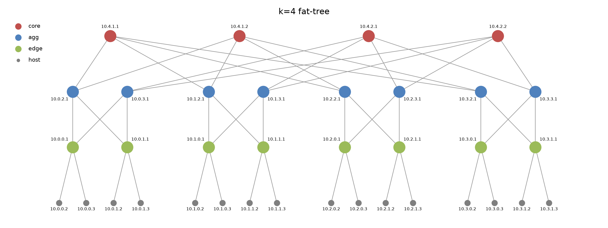
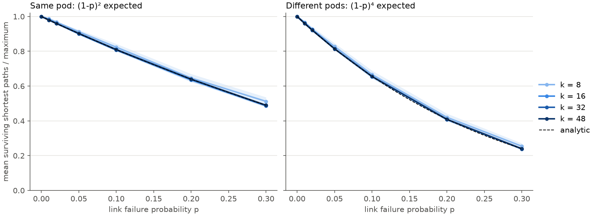
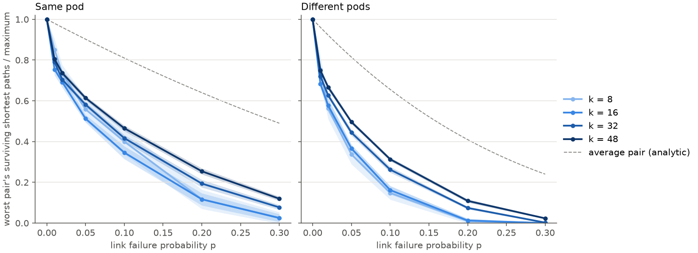

# Fat-Tree Topology Generator & Failure Analysis

## 1. Quick start

**Requirements:** Python ≥ 3.12 and [uv](https://docs.astral.sh/uv/).

```bash
git clone <repo-url> && cd <repo>
uv sync                      # install dependencies into .venv
uv run pytest                # run all tests (topology, failures, metrics, CLI)
```

**Reproduce all figures:**
```bash
uv run draw_topology.py --k 4                     # Figure 1 -> Resources/topology_k4.png
uv run simulate.py --config configs/exp_1.yaml    # Experiment 1 (§5) -> results/Exp_1
uv run plot_exp_1.py results/Exp_1/results.csv    # writes exp1_mean.png, exp1_worst.png next to the CSV
```

**Single run example:** k=8, 5% link failures, 50 trials.
```bash
uv run simulate.py --k 8 --fail-rate 0.05 --trials 50 --out results/demo
```

### Inputs

Inputs can be given on the command line or in a YAML config file (`--config`). Keys are the flag names with underscores. Command-line values override the config file. Flags marked *sweep* accept several values, and the program runs every combination.

| Flag | Default | Meaning |
|---|---|---|
| `--k` *(sweep)* | required | Ports per switch. Even, 4 ≤ k ≤ 254 (the cap comes from the one-byte addressing of [1, §3.2]). Builds the canonical fat-tree of [1, §2.2]: k pods, (k/2)² core switches, k³/4 hosts. |
| `--fail-rate` *(sweep)* | `0` | Link failure rate p ∈ [0, 1] |
| `--fail-switches` *(sweep)* | `0` | Switch failure rate q ∈ [0, 1]. A failed switch is removed together with all its links ([1, §3.8]). Only aggregation and core switches are eligible, because a failed edge switch simply disconnects its hosts. Applied before link failures. |
| `--fail-scope` | `switch-links` | `switch-links`: only edge–aggregation and aggregation–core links can fail (k³/2 links); these are the failures [1, §3.8] can survive. `all-links`: host–edge links can fail too (3k³/4 links); a failed host link always disconnects that host. |
| `--pairs` | `all` | Which (source, destination) pairs the metrics use. `all`: every pair. `N`: N pairs sampled uniformly (for large k). Pairs are edge switches under `switch-links` (exact, since all hosts under one edge switch share the same paths) and hosts under `all-links`. Pairs under the same edge switch are excluded, because their traffic never enters the fabric. |
| `--trials` | `30` | Independent failure samples for each parameter combination. Plots show the mean ± 95% CI over trials. |
| `--seed` | `0` | Base random seed. Trial t uses seed + t, so every trial is reproducible and the same draws are reused across failure rates. |
| `--config` | none | YAML file with any of the flags above. |
| `--out` | results | Output directory. |

### Outputs (`--out DIR`)

- `config.json`: the exact parameters used, after combining the command line and the config file.
- `results.csv`: one row per (k, p, q, trial). Columns:
  - `intra_*` and `inter_*`: pairs in the same pod and in different pods.
  - `*_mean`: mean number of surviving shortest paths per pair (maximum k/2 intra-pod, (k/2)² inter-pod).
  - `*_min`: the worst pair's number of surviving paths.
- `exp1_mean.png`, `exp1_worst.png`: Experiment 1 figures (§5), written next to the CSV by `plot_exp_1.py`.

## 2. Background: the k-ary fat-tree ([1, §2.2])
A k-ary fat-tree is built entirely from identical k-port switches arranged in three layers. It has k **pods**. Each pod contains k/2 **edge** switches and k/2 **aggregation** switches, fully connected to each other. Each edge switch serves k/2 hosts. On top sit (k/2)² **core** switches, arranged in a (k/2)×(k/2) grid. Core row i connects to aggregation switch i in every pod, so each core switch has exactly one port to each pod. Every switch uses all k ports.

<table><tr><td valign="top">

| Quantity | Formula |
|---|---|
| Pods | k |
| Edge switches | k²/2 |
| Aggregation switches | k²/2 |
| Core switches | (k/2)² |
| **Total switches** | 5k²/4 |
| **Hosts** | k³/4 |
| Shortest paths, same edge switch (switched locally, 0 hops) | 1 |
| Shortest paths, same pod (2 edge-to-edge hops) | k/2 |
| Shortest paths, different pods (4 edge-to-edge hops) | (k/2)² |

</td><td valign="top">

| Links | Formula |
|---|---|
| Host–edge | k³/4 |
| Edge–aggregation | k³/4 |
| Aggregation–core | k³/4 |
| **Total** | 3k³/4 |
| Switch–switch (failure candidates) | k³/2 |

</td></tr></table>



*Figure 1: The k=4 fat-tree built by our generator, with the addresses of [1, §3.2]. Each edge switch and its k/2 hosts form one /24 subnet (10.pod.switch.0/24). Generated by `uv run draw_topology.py --k 4`.*

## 3. Implementation

| File | Role |
|---|---|
| `fattree/topology.py` | `build_fat_tree(k)`: builds the fat-tree of §2 as a NetworkX graph. |
| `fattree/failures.py` | `inject_failures(...)`: returns a failed copy of the graph (§4.1–4.2). |
| `fattree/metrics.py` | `surviving_paths(...)`: surviving shortest paths per edge-switch pair (§4.3). |
| `simulate.py` | Experiment runner: parameter sweeps, trials, seeds; writes `results.csv` and `config.json`. |
| `plot_exp_1.py` | Experiment 1 figures: mean ± 95% CI over trials for the average and the worst pair, with the analytic curves of §4.4.1. |
| `draw_topology.py` | Draws the topology (Figure 1), optionally with failures marked. |

**Topology.** Nodes are named `e_{pod}_{i}`, `a_{pod}_{i}`, `c_{j}_{i}` and `h_{pod}_{edge}_{id}`, and carry their layer, pod and IP address from [1, §3.2]. Each link records its class (host–edge, edge–aggregation, aggregation–core) and the port number at both ends. Ports 0…k/2−1 face down and k/2…k−1 face up. Aggregation switch i, port k/2+j connects to core c_{i,j}.

**Failures.** The healthy graph is built once per k. Each trial copies it, removes failed aggregation and core switches (together with their links), then removes failed in-scope links. Every element gets exactly one uniform draw, which is what makes the failure sets nested across rates (§4.2).

**Path counting.** Paths are never enumerated. For each failed graph we build two boolean arrays: `up[pod, edge, i]` (edge–aggregation links alive) and `core[pod, i, j]` (aggregation–core links alive). From these, `shared[x, y, i] = Σ_j core[x,i,j]·core[y,i,j]` counts the cores in row i that reach both pods x and y. The number of surviving paths of a pair is then

- intra-pod: Σᵢ up[e₁,i]·up[e₂,i]
- inter-pod: Σᵢ up[e₁,i]·up[e₂,i]·shared[x₁,x₂,i]

This is vectorized over all pairs with NumPy.

## 4. Failure Modeling
### 4.1 What can fail
- **Links** (`--fail-rate p`). By default (`--fail-scope switch-links`), only switch-to-switch links can fail: edge–aggregation and aggregation–core, k³/2 links in total. These are the two failure classes the paper's fault-tolerance scheme can route around ([1, §3.8]). Host–edge links are excluded by default: a host has a single uplink, so losing it disconnects the host whatever the fabric does. `--fail-scope all-links` adds them, and that only adds loss no routing can recover.
- **Switches** (`--fail-switches q`). A failed switch is removed together with all of its links, matching [1, §3.8] ("switch failures trigger the same BFD alerts and elicit the same responses"). Only aggregation and core switches are eligible. A failed edge switch disconnects its hosts, which is the same argument as for host links.
- **Order:** switch failures are applied first, then link failures on the in-scope links that remain.
### 4.2 How failures are sampled
Failures are independent Bernoulli trials: every eligible link fails with probability p, and every eligible switch with probability q, independently of all other elements. The failure percentage from the assignment is therefore read as a per-element failure probability. The expected failed fraction is p, with standard deviation √(p(1−p)/L) for L eligible links. That is about one percentage point or less for k ≥ 16 (k = 16, L = 2048: ±0.66 pp at p = 0.1, ±1.0 pp at p = 0.3). Independence is the standard failure model, and it makes the expectations in §4.4 exactly computable.

**Seeds and nesting.** Trial t uses seed `seed + t`. Each element gets one uniform draw u and fails if u < p (or q). The draws don't depend on the rate, so for a fixed seed the failure sets are nested: everything that fails at p = 0.05 also fails at p = 0.1. All rates are compared on the same random draws (common random numbers), which keeps the curves smooth and monotone. Switch draws come before link draws, so nesting in p holds for each fixed q.
### 4.3 What counts as a surviving path
We count **shortest (equal-cost) paths** between pairs of edge switches. Under `switch-links` scope, every host under an edge switch sees the same paths, so edge switches are the exact endpoints. Pairs under the same edge switch are excluded, because their traffic never enters the fabric. Because of the fat-tree structure, every shortest path is fixed by a small choice:
- **Same pod:** e₁ → aggregation switch aᵢ → e₂. There are k/2 paths in total, one per i ∈ {1,…,k/2}.
- **Different pods:** e₁ → aᵢ (pod 1) → core c_{i,j} → aᵢ (pod 2) → e₂. Core row i connects only to aggregation switch i in every pod, so both pods use the same i. There are (k/2)² paths in total, one per (i, j).

A path **survives** if all of its links and switches are alive.
### 4.4 Analytical results
We derive the expected number of surviving shortest paths between a pair of edge switches. All failures are independent (§4.2). Let $s = 1-p$ be the probability that a link survives, and $r = 1-q$ the probability that a switch survives.

#### 4.4.1 Link failures ($q = 0$)
Every switch-to-switch link fails with probability $p$, independently; no switch fails.
##### Intra-pod pairs
Let $e_1$ and $e_2$ be two different edge switches in the same pod. There are $k/2$ shortest paths (2 links each) between them, one through each aggregation switch of the pod:

$$e_1 \leftrightarrow a_i \leftrightarrow e_2, \qquad i \in \{1,\dots,k/2\}$$

A path survives only if both of its links survive, so $P(e_1 \leftrightarrow a_i \leftrightarrow e_2 \text{ survives}) = s^2$.\
We define $B_{i} \sim \mathrm{Ber}(s^2)$ as the indicator that equals 1 if $e_1 \leftrightarrow a_i \leftrightarrow e_2$ survived. Different paths use disjoint links, so the $B_i$ are **independent**.\
We define $X = \sum_{i=1}^{k/2} B_{i}$, the number of surviving paths between $e_1$ and $e_2$. Then $X \sim \mathrm{Bin}(k/2,\, s^2)$ and

$$\mathbb{E}[X_{\text{intra}}] = \frac{k}{2}\, s^2$$

##### Inter-pod pairs
Let $e_1$ and $e_2$ be edge switches in different pods. Denote by $a_i^{(1)}$ and $a_i^{(2)}$ the $i$-th aggregation switch of each pod, and by $c_{i,j}$ the $j$-th core switch in core row $i$. Core row $i$ connects only to aggregation switch $i$ of every pod, so a shortest path (4 links) must use the same index $i$ on both sides:

$$e_1 \leftrightarrow a_i^{(1)} \leftrightarrow c_{i,j} \leftrightarrow a_i^{(2)} \leftrightarrow e_2, \qquad i, j \in \{1,\dots,k/2\}$$

This gives $(k/2)^2$ shortest paths, one per core switch. A path survives only if all four of its links survive, so $P(\text{path } (i,j) \text{ survives}) = s^4$.\
We define $B_{i,j} \sim \mathrm{Ber}(s^4)$ as the indicator that equals 1 if path $(i,j)$ survived, and $X = \sum_{i=1}^{k/2}\sum_{j=1}^{k/2} B_{i,j}$, the number of surviving paths between $e_1$ and $e_2$.\
Unlike the intra-pod case, the $B_{i,j}$ are **not independent**: all $k/2$ paths with the same $i$ share the links $e_1 \leftrightarrow a_i^{(1)}$ and $a_i^{(2)} \leftrightarrow e_2$, so if one of those fails, all $k/2$ paths of row $i$ fail together. $X$ is therefore not binomial. Linearity of expectation does not require independence, however, so

$$\mathbb{E}[X_{\text{inter}}] = \sum_{i=1}^{k/2}\sum_{j=1}^{k/2} \mathbb{E}[B_{i,j}] = \left(\frac{k}{2}\right)^2 s^4$$

Normalized by the number of paths in the healthy network ($k/2$ and $(k/2)^2$), the expected fraction of surviving paths is $s^2$ intra-pod and $s^4$ inter-pod, independent of $k$.

#### 4.4.2 Switch failures ($p = 0$)
We now fail switches instead of links: every aggregation and core switch fails with probability $q$, independently, and no link fails on its own ($p = 0$). Edge switches never fail, so every pair still has both of its endpoints.

**Intra-pod pairs.** Path $e_1 \leftrightarrow a_i \leftrightarrow e_2$ survives exactly when $a_i$ survives. Different paths use different aggregation switches, so $B_i \sim \mathrm{Ber}(r)$ are independent, $X \sim \mathrm{Bin}(k/2,\, r)$ and

$$\mathbb{E}[X_{\text{intra}}] = \frac{k}{2}\, r$$

**Inter-pod pairs.** Path $(i,j)$ survives when $a_i^{(1)}$, $c_{i,j}$ and $a_i^{(2)}$ all survive, so $B_{i,j} \sim \mathrm{Ber}(r^3)$. As in §4.4.1, the paths of row $i$ share $a_i^{(1)}$ and $a_i^{(2)}$, so they are dependent. By linearity:

$$\mathbb{E}[X_{\text{inter}}] = \left(\frac{k}{2}\right)^2 r^3$$

Normalized by the number of paths in the healthy network, the expected fraction of surviving paths is $r$ intra-pod and $r^3$ inter-pod, independent of $k$.

#### 4.4.3 Link and switch failures together
Now both failure types are active: every aggregation and core switch fails with probability $q$, and every switch-to-switch link fails with probability $p$, all independently. A link is usable only if the link itself survives **and** both of its endpoint switches survive. (The simulator applies link failures only to links that survived the switch failures. This gives the same result, since a link attached to a dead switch is dead either way.)

**Intra-pod pairs.** Path $e_1 \leftrightarrow a_i \leftrightarrow e_2$ needs one switch ($a_i$) and two links to survive. These are independent events, so $B_i \sim \mathrm{Ber}(r s^2)$. Different paths still use disjoint switches and links, so the $B_i$ are independent, $X \sim \mathrm{Bin}(k/2,\, r s^2)$ and

$$\mathbb{E}[X_{\text{intra}}] = \frac{k}{2}\, r s^2$$

**Inter-pod pairs.** Path $(i,j)$ needs three switches ($a_i^{(1)}$, $c_{i,j}$, $a_i^{(2)}$) and four links to survive, so $B_{i,j} \sim \mathrm{Ber}(r^3 s^4)$. Paths of the same row $i$ share both aggregation switches and both edge–aggregation links, so they are dependent. By linearity:

$$\mathbb{E}[X_{\text{inter}}] = \left(\frac{k}{2}\right)^2 r^3 s^4$$

§4.4.1 and §4.4.2 are special cases: $q = 0$ ($r = 1$) gives §4.4.1 and $p = 0$ ($s = 1$) gives §4.4.2. Normalized, the expected surviving fractions are $r s^2$ intra-pod and $r^3 s^4$ inter-pod.

#### 4.4.4 What the expectations do not tell
These are per-pair expectations. By linearity of expectation they hold however failures are correlated across pairs, but they say nothing about how the damage is distributed. One failed link removes paths for every pair that uses it, and one failed switch removes paths for many pairs at once. Quantities such as the worst pair's number of surviving paths (`*_min`), or how much the damage varies from one failure sample to the next, depend on the joint failure pattern and have no simple closed form. The simulation measures them, and uses the expectations above to validate itself.

## 5. Experiments

### 5.1 Experiment 1: surviving shortest paths vs. link failure probability

#### Question
How much shortest-path diversity does a fat-tree keep when switch-to-switch links fail at random, and how does that depend on the switch size k? Concretely:
1. **Average pair:** does the mean fraction of surviving shortest paths per edge-switch pair follow the expectations of §4.4.1, $s^2$ intra-pod and $s^4$ inter-pod, for every k?
2. **Worst pair:** how far below the average does the worst-off pair of edge switches fall, and how does that gap change with k? §4.4.4 explains why this has no simple closed form.

#### Setup
| Parameter | Value |
|---|---|
| Switch size k | 8, 16, 32, 48 (128 to 27,648 hosts; k = 48 is the example of [1, §2.2]) |
| Link failure probability p | 0, 0.01, 0.02, 0.05, 0.1, 0.2, 0.3 |
| Switch failure probability q | 0 |
| Failure scope | `switch-links` (edge–aggregation and aggregation–core links) |
| Pairs | all edge-switch pairs, split into intra-pod and inter-pod (table below) |
| Trials | 30 independent failure samples per (k, p), seeds 0–29 |

| k | Edge switches | Intra-pod pairs | Inter-pod pairs | Max paths (intra / inter) |
|---|---|---|---|---|
| 8 | 32 | 48 | 448 | 4 / 16 |
| 16 | 128 | 448 | 7,680 | 8 / 64 |
| 32 | 512 | 3,840 | 126,976 | 16 / 256 |
| 48 | 1,152 | 13,248 | 649,728 | 24 / 576 |

**Measured per trial**, separately for intra-pod and inter-pod pairs:
- **mean surviving fraction:** the average over pairs of (surviving shortest paths) / (maximum: k/2 or (k/2)²);
- **worst-pair fraction:** the minimum over pairs of the same ratio.

Each plotted point is the mean over the 30 trials, with a 95% confidence interval (Student-t).

```bash
uv run simulate.py --config configs/exp_1.yaml
uv run plot_exp_1.py results/Exp_1/results.csv
```

#### Results



*Figure 2: Mean fraction of surviving shortest paths per edge-switch pair vs. link failure probability p. Dashed: the analytic expectations $(1-p)^2$ and $(1-p)^4$ of §4.4.1.*



*Figure 3: The worst-off pair's fraction of surviving shortest paths vs. p. Dashed gray: the average pair (analytic), for reference.*

| p = 0.1 | k = 8 | k = 16 | k = 32 | k = 48 | analytic |
|---|---|---|---|---|---|
| mean, intra-pod | 0.824 | 0.807 | 0.811 | 0.809 | 0.810 |
| mean, inter-pod | 0.666 | 0.655 | 0.655 | 0.655 | 0.656 |
| worst pair, intra-pod | 0.400 | 0.346 | 0.417 | 0.465 | — |
| worst pair, inter-pod | 0.148 | 0.162 | 0.262 | 0.313 | — |

#### Discussion
**The average pair matches the analysis (Figure 2).** For k ≥ 16, every point is within 0.003 of $(1-p)^2$ and $(1-p)^4$, which validates the simulator. The average surviving fraction does not depend on k. Larger fabrics only reduce the trial-to-trial noise, because they average over more links.

**The worst pair is far from the average (Figure 3).** At p = 0.01 the average pair loses 2–4% of its paths, while the worst pair loses 20–30%. At p = 0.1, even in the k = 48 fabric (27,648 hosts), the worst inter-pod pair keeps only 31% of its paths, against an average of 66%. The cause is the edge layer. An edge switch has only k/2 uplinks, and among k²/2 edge switches a few always lose several of them. Every pair touching such a switch loses a large share of its paths at once. Larger k helps (worst inter-pod at p = 0.1: 0.16 → 0.26 → 0.31 for k = 16 → 32 → 48), but the gap to the average stays large.

**Why this matters for AI factories.** Training jobs synchronize through collective operations (e.g. all-reduce), which complete only when the *slowest* participating flow does. A flow between a badly hit pair of racks has fewer live uplinks to spread its traffic over, so it becomes that straggler. The average path diversity, which is what a per-link analysis gives, looks comfortable at any scale. But a collective spanning thousands of hosts almost certainly includes the worst pair, so its speed is set by the minimum of Figure 3, not the mean of Figure 2. For such workloads, fat-tree resilience should be judged by its worst-case path diversity, and the edge uplinks are where it is lost.


## References
[1] M. Al-Fares, A. Loukissas, and A. Vahdat, "A scalable, commodity data center network architecture," *SIGCOMM Comput. Commun. Rev.*, vol. 38, no. 4, pp. 63–74, Oct. 2008. doi: [10.1145/1402946.1402967](https://doi.org/10.1145/1402946.1402967)

## AI usage
This project was developed with the help of Claude (Anthropic). Claude was used as a reading companion for [1], for discussing the simulator design and the analytical derivations, for generating and refactoring code via Claude Code, and for drafting parts of this README.
